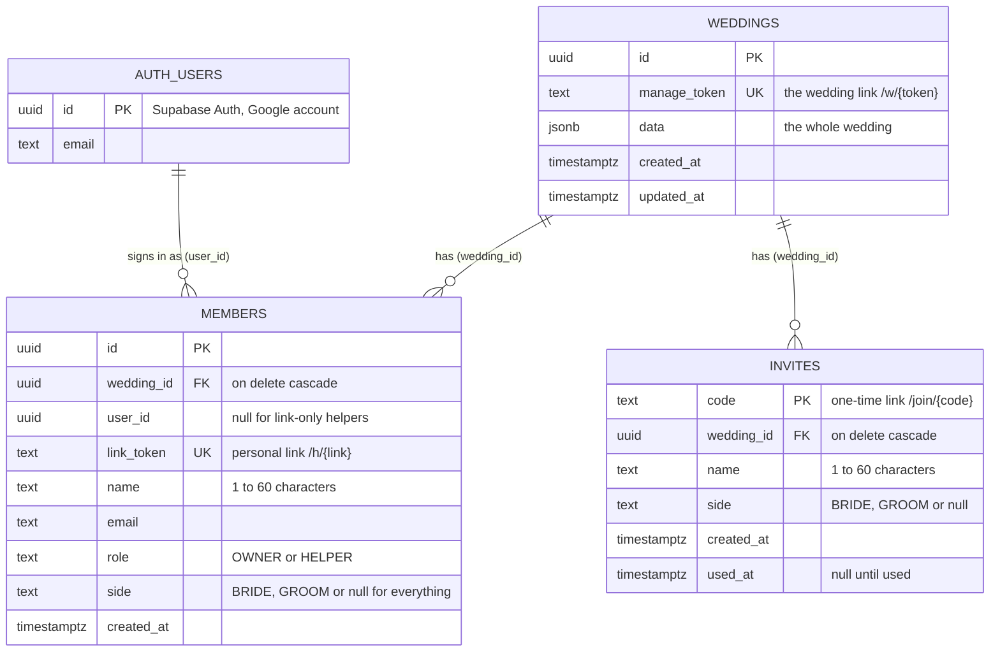
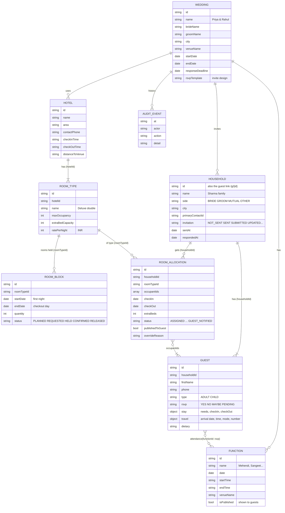

# Database

Postgres on Supabase (project `weddingstay`, Mumbai). The tables are created by [`backend/schema.sql`](../backend/schema.sql), which is safe to run again.

There are three tables:

| Table | What one row is |
|---|---|
| `weddings` | One wedding, with everything in it (families, guests, functions, hotels, rooms) as one JSON document |
| `members` | One person who can manage a wedding besides its wedding link: the couple (OWNER) or a helper (HELPER) |
| `invites` | One one-time helper invite link sent on WhatsApp |

Sign-in accounts live in Supabase's own `auth.users` table. We don't copy them: `members.user_id` holds the user's id (the `sub` in their sign-in token).

## Relationships

- A wedding has many members and many invites. Deleting a wedding deletes them too.
- A Google account can be a member of many weddings (My weddings), but only once per wedding: `unique (wedding_id, user_id)`.
- `auth.users` is drawn for clarity. There's no foreign key to it, so the app's tables don't depend on Supabase Auth and can move to another Postgres.

## `weddings`

| Column | Type | Rules | Meaning |
|---|---|---|---|
| `id` | uuid | primary key | Made by the server (`crypto.randomUUID()`) |
| `manage_token` | text | not null, unique | The wedding link's secret (about 120 random bits) |
| `data` | jsonb | not null | The whole wedding (see below) |
| `created_at` | timestamptz | default now() | |
| `updated_at` | timestamptz | default now() | Set on every change |

Index: `weddings_households`, a GIN index on `data -> 'households'`. A guest link is `/g/{familyId}`, and this index finds the wedding that has that family in one step.

## `members`

| Column | Type | Rules | Meaning |
|---|---|---|---|
| `id` | uuid | primary key, default `gen_random_uuid()` | Used to remove a helper |
| `wedding_id` | uuid | not null, references `weddings(id)` on delete cascade | |
| `user_id` | uuid | nullable, indexed | Supabase Auth user id. Null for a helper who chose not to sign in. |
| `link_token` | text | unique, nullable | That helper's personal link (about 120 bits) |
| `name` | text | 1 to 60 characters | Shown in "Who's helping" |
| `email` | text | nullable | From Google |
| `role` | text | `OWNER` or `HELPER` | OWNER is the couple |
| `side` | text | `BRIDE`, `GROOM` or null | Null means the whole wedding. A side means that side's families plus families for both sides. |
| `created_at` | timestamptz | default now() | |

Checks:
- `unique (wedding_id, user_id)`: once per wedding for each Google account. Joining again as OWNER upgrades the row.
- `check (user_id is not null or (link_token is not null and role = 'HELPER'))`: every member either signed in with Google or is a helper with a personal link. The couple always signs in, so the couple can't be link-only.

## `invites`

| Column | Type | Rules | Meaning |
|---|---|---|---|
| `code` | text | primary key | The `/join/{code}` link (about 120 bits) |
| `wedding_id` | uuid | not null, references `weddings(id)` on delete cascade, indexed | |
| `name` | text | 1 to 60 characters | Who it's for ("Mummy", "Rahul bhaiya") |
| `side` | text | `BRIDE`, `GROOM` or null | Becomes the helper's side |
| `created_at` | timestamptz | default now() | Invites expire 14 days after this |
| `used_at` | timestamptz | nullable | Set when used. Marking it used is a single update, so an invite can never be used twice. |

Limits checked in code (`teamRepository.ts`): at most 30 helpers plus open invites per wedding (`MAX_TEAM`), and invites last 14 days (`INVITE_DAYS`).

## Access and security

| | `weddings` | `members` | `invites` |
|---|---|---|---|
| Row-level security | on | on | on |
| Policy | `server_all` for `weddingstay_api` | same | same |
| `weddingstay_api` (the server) | select, insert, update | select, insert, update, delete | select, insert, update, delete |
| `anon`, `authenticated` (Supabase's public API) | none | none | none |

The server connects as `weddingstay_api` through Supabase's transaction pooler (port 6543), with `prepare: false` and one connection per function. Nothing in the browser can read the tables directly, even with the public key.

## What's inside `weddings.data`

`data` is a `WeddingData` document (`shared/types.ts`). Inside it, records point to each other by id:

| List in `data` | Key fields |
|---|---|
| `wedding` | Names, city, venue, dates, reply deadline, invite design |
| `functions[]` | Name, date, time, venue, `isPublished` |
| `households[]` | The family. Its `id` is the guest link. Side, invite state, dates sent and replied. |
| `guests[]` | `householdId`, name, phone, adult or child, RSVP, `attendance` per function, `stay` (needs a room, dates), `travel` |
| `hotels[]`, `roomTypes[]` | The hotel, and its room types with capacity and rate |
| `blocks[]` | Rooms held at a hotel for a date range. Only HELD or CONFIRMED rooms can be given out. |
| `allocations[]` | A room given to a family: who stays, dates, extra beds, status, whether the family can see it |
| `audit[]` | History, newest first ("Room allocated", "Reply noted for ...") |
| `members[]` | Only the sample team in the demo. Real teams are in the `members` table. |

Every change to `data` goes through `shared/reducer.ts` (see [System design](system-design.md#one-idea-at-the-centre-the-reducer)).

## Why one JSON row per wedding

One wedding is a few hundred guests at most, and it's always read and changed as a whole. So one row means:
- the couple's screen loads with one read;
- each change is one locked update, so two people changing the wedding at once can't clash;
- the browser and the server run the same reducer on the same shape.

The cost is that reports across many weddings are harder. `backend/schema.prisma` holds the fully relational draft (users, weddings, households, guests, hotels, blocks, allocations as separate tables), ready for when that's needed.
