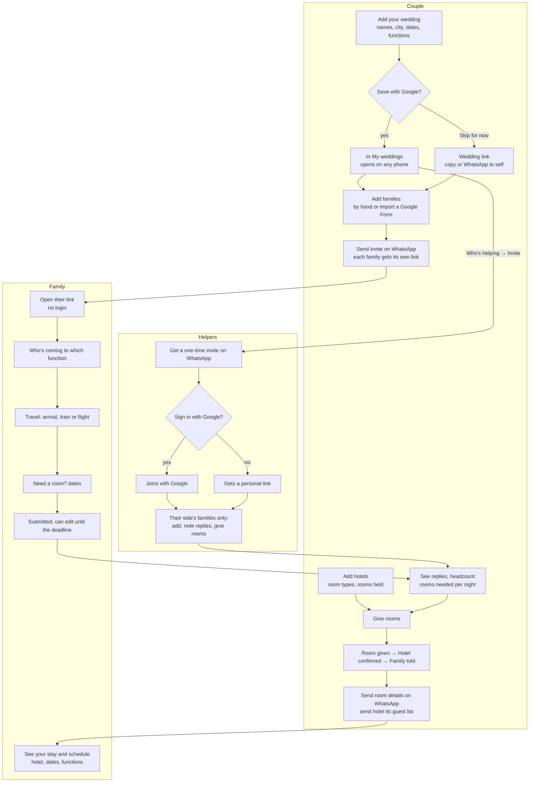
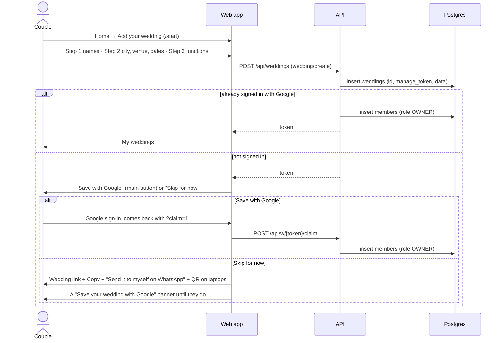
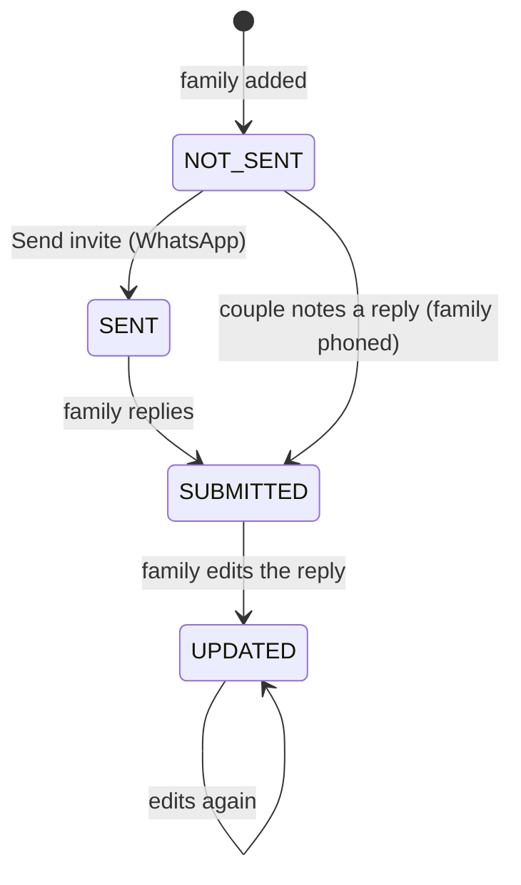
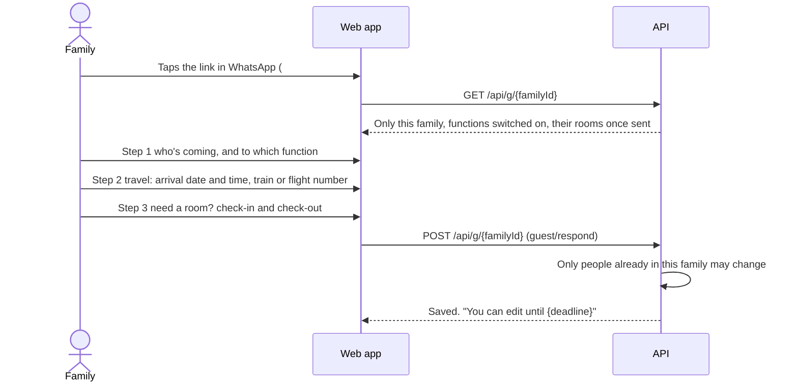
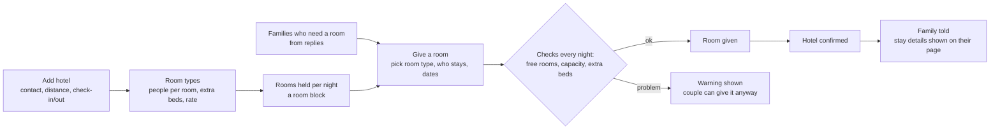
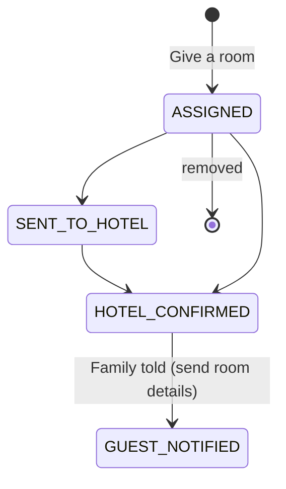
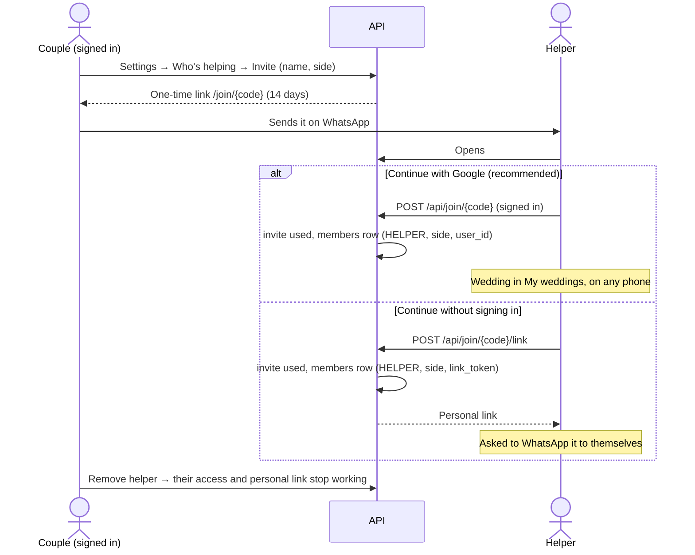
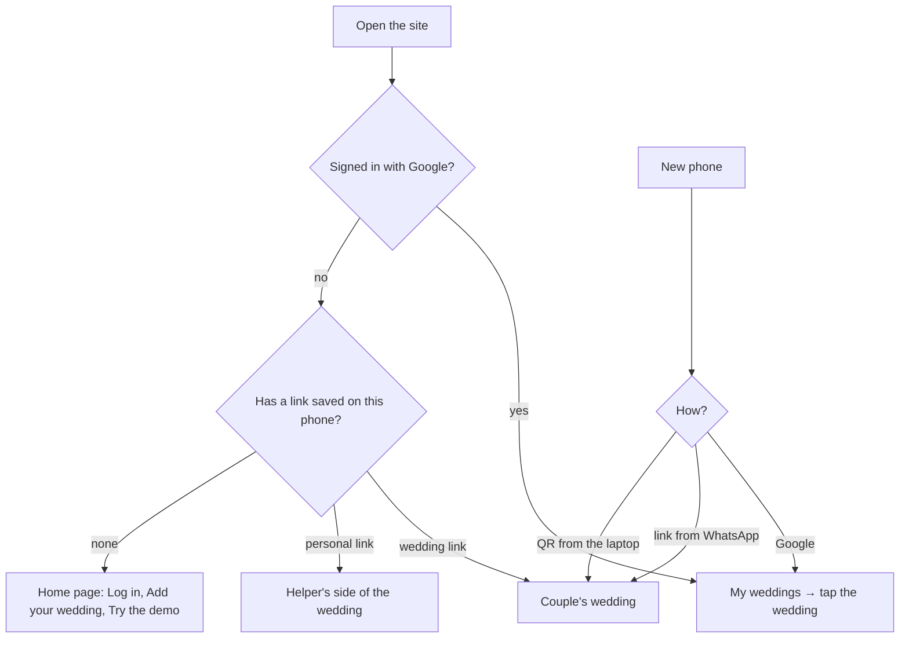

# Product flows

What each person does in WeddingStay, step by step, from the couple setting up their wedding to a family seeing their hotel room. Screens are named as they appear in the app.

## The whole journey on one page

## 1. The couple starts a wedding

- The wedding link is like a Google Doc shared by link: anyone who has it can manage the wedding. That's why the app pushes **Save with Google** first.
- On a laptop, the **Open on your phone** QR code opens the same wedding on the phone. Signed-in people get a QR of the login page instead, which holds no secret.

## 2. Adding families and sending invites

1. **Guests → Add a family**: family name, whose side (bride's, groom's, both), main contact, WhatsApp number (10-digit Indian mobile), and how many adults and kids. Names can be left blank, because the family fills them in.
2. Or **Import from Google Form**: upload the CSV or paste the Sheet link. The app matches columns, groups rows into families, and flags rows to check (for example a leaving date before arrival). Then it adds them all at once.
3. **Send invite** opens WhatsApp with a ready message and the family's own link `#/g/{familyId}`, and marks the invite as **Sent**.
4. Families who haven't replied can be reminded the same way.

Invite states for each family:

## 3. A family replies (guest side)

- No login, no app to install. The link works only for that family.
- If a family phones instead, the couple uses **Give a room to any family** (or notes their reply). The history says "Reply noted for ... family" by the couple.

## 4. Hotels and rooms

- Stays count nights: check-in is included and check-out isn't. 10 Dec → 12 Dec means the nights of 10 and 11 Dec.
- **Home** shows rooms needed against rooms held for each night, so shortages show up early.
- **Send list** sends each hotel its guest list on WhatsApp.
- A family sees its hotel only after **Family told** (`publishedToGuest`).

Room states:

## 5. Helpers (parents, siblings, cousins)

What a helper can and can't do:

| Can | Can't |
|---|---|
| See families on their side and families for both sides | See the other side's families |
| Add families on their side | Add or switch on functions |
| Note replies for those families | Change the invite design |
| Give rooms to those families | Invite or remove helpers |

Limits: up to 30 helpers and open invites per wedding. An invite works once.

## 6. Opening the wedding again later

## 7. Demo

`#/demo` opens a sample wedding (Ananya & Rohan, Udaipur, 32 families, 3 hotels) in the browser only. Nothing is saved, and every name is made up (`shared/sample.ts`). Settings shows a sample team.

## Not built yet

- Login with WhatsApp or phone OTP (needs WhatsApp Business verification, or DLT plus an SMS provider)
- Editing wedding details after creating the wedding (the screen is a preview for now)
- Automatic WhatsApp reminders (today the couple sends them from their own phone)
- An installable phone app (PWA or Capacitor)
