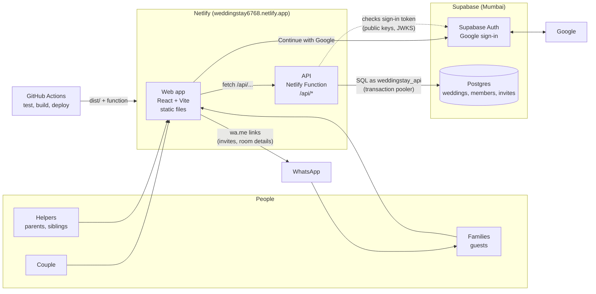
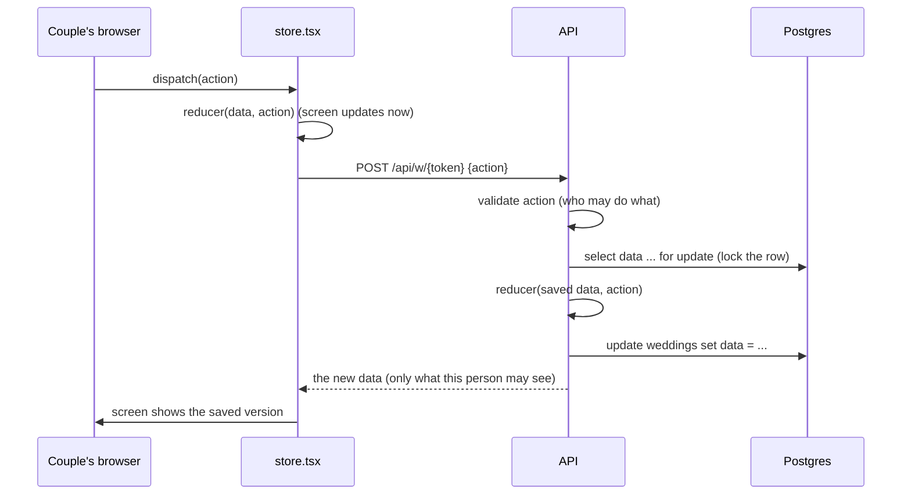
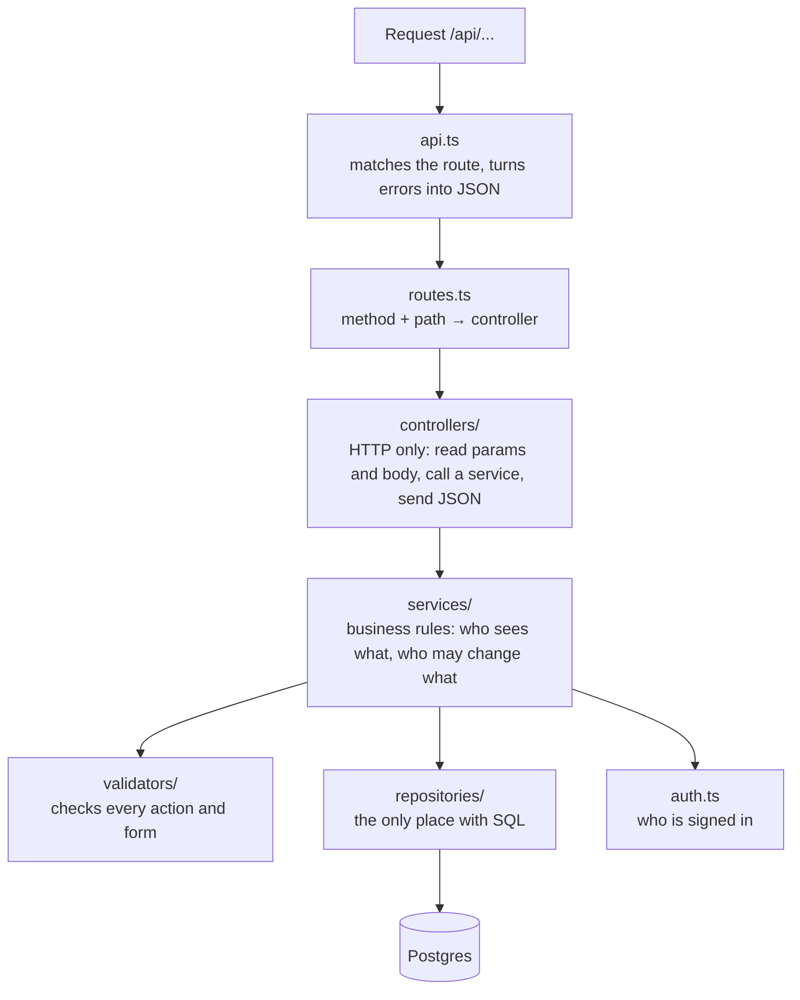
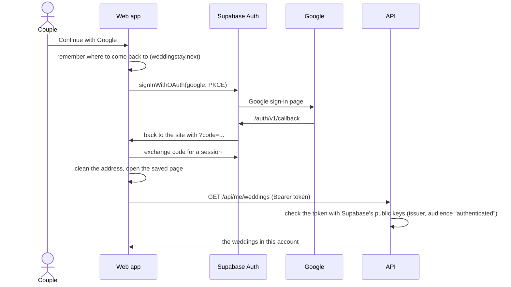
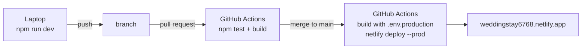

# System design

WeddingStay is one web app (React) and one API (a Netlify Function), both served from the same Netlify site, with a Postgres database and Google sign-in on Supabase.

## The big picture

| Part | Tech | Where |
|---|---|---|
| Web app | Vite, React 18, TypeScript, Tailwind, `HashRouter` (`#/...` pages) | `frontend/` |
| API | One Netlify Function on `/api/*`, layered (routes → controllers → services → validators → repositories) | `backend/` |
| Shared code | Types, the reducer (every change to a wedding), sample data, dates, invite designs | `shared/` |
| Database | Postgres on Supabase, reached with `postgres` (porsager) through the transaction pooler | `backend/schema.sql` |
| Sign-in | Supabase Auth with Google, PKCE flow | `frontend/lib/auth.ts`, `backend/auth.ts` |
| Messages | WhatsApp share links (`wa.me/?text=...`), sent from the user's own phone. No WhatsApp API yet. | `frontend/pages/*` |
| Deploys | GitHub Actions on push to `main`: tests, build, `netlify deploy --prod` | `.github/workflows/deploy.yml` |

Locally, `npm run dev` runs the same API inside Vite as middleware, so one command serves both on http://localhost:5173.

## One idea at the centre: the reducer

Every change to a wedding is an **action** (`allocation/add`, `guest/respond`, `household/add`, ...) applied by one function, `reducer(data, action)` in `shared/reducer.ts`.

- In the browser it updates the screen straight away.
- On the server the same function runs again, inside a database row lock, on the saved wedding.

So the app and the API can never disagree about what an action does, and two people changing the same wedding at once (the couple and a family replying) can't overwrite each other.

## Backend layers

| Layer | Files | Job |
|---|---|---|
| Entry | `backend/api.ts`, `backend/functions/api.mts` | Netlify entry point, route matching, error handling. Answers 503 if `DATABASE_URL` is missing. |
| Routes | `backend/routes.ts` | Every endpoint in one list |
| Controllers | `weddingController`, `guestController`, `teamController`, `docsController` | HTTP in and out, nothing else |
| Services | `weddingService` (couple and members), `guestService` (families), `teamService` (helpers, invites, My weddings) | Rules and views |
| Validators | `validators/actions.ts`, `validators/team.ts` | Sizes, formats, which side a helper may touch |
| Repositories | `weddingRepository`, `teamRepository` | SQL. Swapping the database means changing only these. |
| Auth | `backend/auth.ts` | Verifies the Supabase sign-in token (JWT) |

The full API list, with request and response shapes, is at `/api/docs` (Swagger, from `backend/openapi.ts`).

## Who can open a wedding (the five ways in)

| Who | How they get in | Address | What they see and can do |
|---|---|---|---|
| Anyone trying it | Demo | `#/demo` | A sample wedding in the browser only. Nothing is saved. |
| Couple, no account | **Wedding link** (private link) | `#/w/{token}` → `/api/w/{token}` | Everything |
| Couple or helper, signed in | **Google** | `#/me`, then `/api/weddings/{id}` with `Authorization: Bearer ...` | Couple: everything. Helper: their side only. |
| Helper, no account | **Personal link** | `#/h/{link}` → `/api/h/{link}` | Their side only |
| A family | **Guest link** | `#/g/{familyId}` → `/api/g/{familyId}` | Only their own family's invite, reply and stay |

The browser remembers which one it is using in `localStorage` (`weddingstay.token`, `weddingstay.wedding`, `weddingstay.helper`), so reopening the site goes back to the same wedding. On start, `store.tsx` tries them in order: signed-in wedding, helper link, wedding link, then the demo.

### What each person is allowed to see

The server never sends more than a person may see:

- **Couple (owner):** the whole wedding.
- **Helper:** `helperView` removes families from the other side (they keep families marked MUTUAL, "both sides"), their guests and rooms, the team list and the history.
- **Family:** `guestView` keeps only their own family and guests, the functions switched on for guests, and hotel details only once the couple has sent them.

And the server checks every change:

- A wedding link or signed-in member can't use demo-only actions (`reset`, `wedding/create`).
- A helper can't add or publish functions, change the invite design, or touch families from the other side (`validateHelperAction`).
- A guest link can only send `guest/respond` for people already in its own family (`validateGuestReply`).

## Google sign-in

- Only the couple and helpers sign in, and only if they want to. Families never do.
- No `/auth` page and no session of our own: the API checks the Supabase token on every call (`backend/auth.ts`, using `jose`).
- A wedding made without an account can be linked later: **Save with Google** calls `POST /api/w/{token}/claim`, which adds the signed-in person as its OWNER.

## Links and how hard they are to guess

| Link | Made by | Strength |
|---|---|---|
| Wedding link `/w/{token}` | `newId() + newId()` | 24 characters from 32, about 120 bits |
| Helper personal link `/h/{link}` | same | about 120 bits. Turned off when the couple removes the helper. |
| Helper invite `/join/{code}` | same | One use, expires after 14 days |
| Guest link `/g/{familyId}` | `newId('h')` | 12 random characters, about 60 bits. Can only reply for that family. |

## Security in short

- **Database:** row-level security is on for every table. Only the server's own role `weddingstay_api` has a policy. Supabase's public API keys (`anon`, `authenticated`) have no access, even though the publishable key is in the web page.
- **Secrets:** `DATABASE_URL` and the Google client secret never reach the browser. `DATABASE_URL` is in `.env.local` locally and in Netlify's environment for the live site. The Google client secret is kept only in Supabase.
- **Validation:** every form is checked on screen and again on the server.
- **Errors:** a wedding you're not part of answers "not found", so it doesn't reveal that it exists.
- **Headers:** `netlify.toml` sets `X-Frame-Options: DENY`, `nosniff`, and a strict referrer policy.

## Deploys

The public Supabase values come from `.env.production` at build time. `DATABASE_URL` and `VITE_SUPABASE_URL` for the API come from Netlify's environment variables. More detail in the main README, *Deploy on Netlify*.

## Choices made, and what would change them

| Choice | Why | When to revisit |
|---|---|---|
| One `jsonb` row per wedding | One wedding is small (hundreds of guests). One read and one locked write per change keeps it simple and consistent, and the same reducer runs on both sides. | Many weddings per account with reports across them, or very large weddings. `backend/schema.prisma` has the fully relational draft. |
| `members` and `invites` as real tables | They join weddings to people and need lookups by user, link and code | — |
| Supabase Auth with Google only | No passwords, and people already have a Google account | WhatsApp or phone OTP login is planned |
| No WhatsApp API | `wa.me` links cost nothing and need no business verification | Automatic reminders or OTP |
| Netlify Function (one per site) | No server to run, and the same origin as the web app | Long jobs or heavy traffic |
| Plain SQL in repositories | Easy to move off Supabase later | — |
